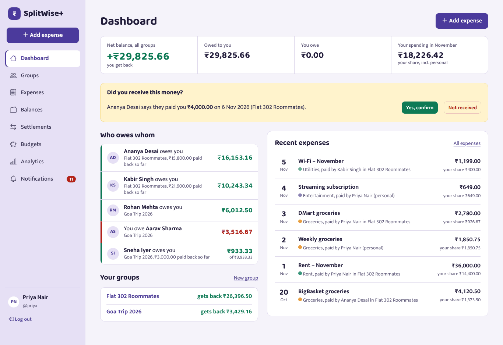

# SplitWise+ — Personal Expense Sharing and Settlement System

DBMS mini project (team of 3). Track shared expenses, split them five ways, see who owes whom, settle up, simplify debts, manage budgets and analyse spending.

**Status:** Phase 5 (testing) complete — 252 automated tests + 11 SQL scripts pass (`php tests/run_all.php`), 0 accessibility violations, money scenarios in `docs/TEST_SCENARIOS.md`. Next: team-laptop checklist, then Phase 6 (report and viva). See `docs/IMPLEMENTATION_STATUS.md`.

## Stack
PHP 8.2+ (PDO), MySQL 8.0, Bootstrap 5.3, JavaScript, Chart.js 4, XAMPP (Apache + PHP). Fonts: Baloo 2 and Mukta (Ek Type, SIL Open Font License), stored locally.



## Database setup

> **Use MySQL 8.0, not XAMPP's bundled MariaDB.** The scripts use MySQL 8 features and behaviour (CHECK constraints with FKs, `JSON_TABLE`, `REGEXP_LIKE`, window functions).

1. Install **MySQL 8.0 Community Server**. In the XAMPP Control Panel, stop (do not start) XAMPP's MySQL/MariaDB so port 3306 is free.
2. Check the version: `mysql -u root -p -e "SELECT VERSION();"` must print `8.0.x`.
3. Import the single combined file (drops and recreates database `splitwise_plus`):
   ```bash
   mysql --default-character-set=utf8mb4 -u root -p < database/splitwise_plus.sql
   ```
   phpMyAdmin pointed at MySQL 8.0 also works: Import → `database/splitwise_plus.sql`, character set `utf-8`.
4. Verify the install — every row must say `PASS`:
   ```bash
   mysql --default-character-set=utf8mb4 -u root -p < database/verify_install.sql
   ```
5. Create the app's least-privilege account (edit the password in the file first, put the same one in `.env`):
   ```bash
   mysql -u root -p < database/security/app_user.sql
   ```

`database/splitwise_plus.sql` is generated by `database/build.sh` from the source scripts — edit the sources, then rebuild.

### Sample accounts
All passwords: `Password@123` (sample data only). Users: `admin` (system admin), `aarav`, `priya`, `rohan`, `sneha`, `kabir`, `ananya`, `vikram`, `meera`.

## Running the app (XAMPP)
1. Do the database setup above (including step 5, the app account).
2. Copy the repo folder into `C:\xampp\htdocs\Splitwise` and start **Apache** in XAMPP (keep XAMPP's MySQL stopped).
3. Copy `.env.example` to `.env` and set `DB_USER=splitwise_app` and `DB_PASSWORD` to the password you used in step 5.
4. Check `C:\xampp\php\php.ini` has `upload_max_filesize` ≥ 6M and `post_max_size` ≥ 8M (XAMPP ships 40M; plain PHP ships only 2M — the receipt field shows the real limit).
5. Open **http://localhost/Splitwise/public/** and log in with a sample account.
   (`http://localhost/Splitwise/` redirects there. Secrets and source code are blocked by `.htaccess`; for production use a VirtualHost with DocumentRoot = `Splitwise/public`.)

Without XAMPP: `php -d upload_max_filesize=6M -d post_max_size=8M -S 127.0.0.1:8000 -t public public/router.php` and open http://127.0.0.1:8000.

**Mock e-mail:** users who tick "Email me" on their profile get a copy of each notification appended to `storage/logs/mail.log` (nothing is really sent).

**Where runtime data lives:** sessions, login-throttle counters and uploaded receipts are stored in MySQL (tables `app_sessions`, `app_kv`, `receipts.content`), so several app servers can share them.

## Deployment (Vercel + managed MySQL)
Prepared, **not deployed yet**: `Dockerfile` + `Caddyfile` (FrankenPHP), health checks `/healthz` and `/readyz`, hosted-DB builder `database/build_hosted.php`. Full guide, provider comparison, env variables and current status: [`docs/DEPLOYMENT.md`](docs/DEPLOYMENT.md).

## Running the tests
One command, Windows or Linux (resets the database to the sample data at the end):
```bash
php tests/run_all.php --password=YOUR_ROOT_PASSWORD
# Windows: C:\xampp\php\php.exe tests\run_all.php --mysql="C:\Program Files\MySQL\MySQL Server 8.0\bin\mysql.exe" --password=...
```
It runs unit (41), every SQL script (11), database (76), functional (115) and money-scenario (23) tests. Linux-only shortcuts: `tests/database/run.sh`, `tests/functional/run.sh`, and `tests/deployment/run.sh` (28 deployment-readiness checks: production mode, hosted-style DB, shared sessions). Before the viva, each member runs `docs/TEAM_TEST_CHECKLIST.md`.

## Running the database tests
```bash
tests/database/run.sh              # needs mysql client + php with pdo_mysql
MYSQL_ARGS="-uroot -psecret" DB_PASS=secret tests/database/run.sh
```

## Repository layout
```text
app/             core/ (router, session, auth, PDO), models/, services/, controllers/, views/
config/routes.php
public/          index.php, router.php, assets/ (css, js, vendor: Bootstrap, icons, Chart.js)
storage/         logs/ (local only; not web-accessible)
database/
  schema/        01_create_database.sql, 02_tables.sql, 03_indexes.sql, 04_infrastructure.sql (sessions, key-value)
  functions/     functions.sql          (3 stored functions)
  views/         views.sql (11 views), demo_views.sql (Experiment 9 operations)
  triggers/      triggers.sql (11 triggers, all 6 timing/event pairs), demo_triggers.sql
  procedures/    procedures.sql         (5 procedures)
  seeders/       sample_data.sql
  queries/       01–06 query collection (Q1–Q50), 07_explain.sql
  transactions/  demo_acid.sql
  security/      app_user.sql           (least-privilege app account)
  verify_install.sql                    (per-laptop install check)
  build.sh, splitwise_plus.sql (combined import), build_hosted.php (managed-MySQL import)
docs/diagrams/   ER diagrams (PNG/SVG)
tools/           generate_er.py (physical ER from live schema), screenshots.py (all screens)
docs/            specification, schema, architecture decisions, experiment mapping,
                 traceability, implementation status, testing report, changelog
tests/            run_all.php (everything), unit/, functional/ (incl. scenarios), database/, deployment/
Dockerfile, Caddyfile, deploy/php.ini, .dockerignore   FrankenPHP container
```

## Documentation
| Doc | Contents |
|---|---|
| `docs/PROJECT_SPECIFICATION.md` | scope, requirements, roles, decisions, risks, edge cases |
| `docs/DATABASE_SCHEMA.md` | ER diagrams, tables, normalization, financial model, DB objects |
| `docs/SQL_EXPERIMENT_MAPPING.md` | Experiments 1–9 → real queries/objects |
| `docs/ARCHITECTURE_DECISIONS.md` | application architecture, ADRs, directory plan |
| `docs/TESTING_REPORT.md` | actual test results |
| `docs/UI_DESIGN_SYSTEM.md` | colours, type, components, breakpoints |
| `docs/DEPLOYMENT.md` | Vercel/FrankenPHP, managed MySQL, migration, env vars, status |
