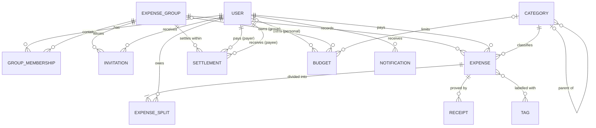
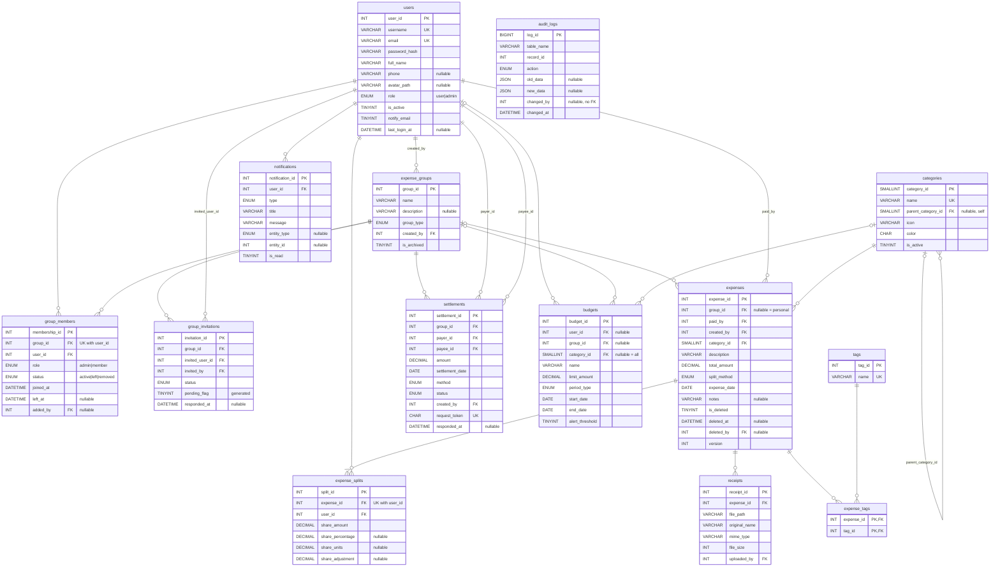

# DATABASE_SCHEMA.md — SplitWise+

Status: **Approved (Phase 1) and implemented (Phase 2).** Source scripts in `database/`; verified on MySQL 8.0.46 (see `TESTING_REPORT.md`).

> Every script starts with `SET NAMES utf8mb4;`. Without it a latin1 client double-encodes `₹`, `–`, `é` (found and fixed during Phase 2 testing).

Target DBMS: **MySQL 8.0** (InnoDB, `utf8mb4`, `utf8mb4_0900_ai_ci`). Database name: `splitwise_plus`.

---

## 1. Design summary

| Item | Decision |
|---|---|
| Tables | 14 (each has one clear purpose; see §3) |
| Keys | Surrogate `INT UNSIGNED AUTO_INCREMENT` PKs; natural candidate keys enforced with `UNIQUE` |
| Money | `DECIMAL(12,2)` everywhere. No `FLOAT`/`DOUBLE` |
| Balances | **Never stored.** Derived from expenses, splits and confirmed settlements (views + functions) |
| Deletion of financial data | Soft delete for expenses; settlements are cancelled/rejected, never deleted once confirmed |
| Audit | Triggers write old/new row snapshots to `audit_logs` |
| Naming | `snake_case`, plural table names, `<entity>_id` keys, `fk_<table>_<column>`, `idx_<table>_<cols>`, `chk_<table>_<rule>`, `trg_<table>_<timing>_<event>`, `v_`, `sp_`, `fn_` prefixes |

`groups` is a **reserved word in MySQL 8.0** (window-frame keyword `GROUPS`), so the group table is named `expense_groups`.

---

## 2. Conceptual ER model (entities and relationships only)



Associative entities: `GROUP_MEMBERSHIP` (User M:N Group, with role/status attributes), `EXPENSE_SPLIT` (User M:N Expense, with share attributes), `EXPENSE_TAG` (Expense M:N Tag).

---

## 3. Logical ER model (keys and attributes)



Image versions for the report (in `docs/diagrams/`):

| Diagram | Files | Notation |
|---|---|---|
| Conceptual | `er_conceptual.png` / `.svg` (source `er_conceptual.dot`) | Chen: entities, double-box associative entities, relationship diamonds, key attributes underlined, cardinality labels, thick line = total participation |
| Physical | `er_physical.png` / `.svg` | every table, column, type, PK/FK/UK, nullability (`?`), FK edges labelled with ON DELETE rule. **Generated from the live database** by `tools/generate_er.py`, so it always matches the real schema — re-run after any schema change |

---

## 4. Physical schema (proposed)

Common columns not repeated below: `created_at DATETIME NOT NULL DEFAULT CURRENT_TIMESTAMP`, `updated_at DATETIME NULL ON UPDATE CURRENT_TIMESTAMP` on all mutable tables.

### 4.1 `users` — registered accounts (system admins are users with `role='admin'`)
| Column | Type | Constraints |
|---|---|---|
| user_id | INT UNSIGNED | PK, AUTO_INCREMENT |
| username | VARCHAR(30) | NOT NULL, UNIQUE, CHECK `CHAR_LENGTH(username) >= 3` |
| email | VARCHAR(100) | NOT NULL, UNIQUE (stored lower-case) |
| password_hash | VARCHAR(255) | NOT NULL (`password_hash()` output) |
| full_name | VARCHAR(100) | NOT NULL |
| phone | VARCHAR(15) | NULL |
| avatar_path | VARCHAR(255) | NULL |
| role | ENUM('user','admin') | NOT NULL DEFAULT 'user' |
| is_active | TINYINT(1) | NOT NULL DEFAULT 1 |
| notify_email | TINYINT(1) | NOT NULL DEFAULT 1 (account setting; mock email only) |
| last_login_at | DATETIME | NULL |

Users are **never hard-deleted** (they are referenced by financial history); they are deactivated.

### 4.2 `expense_groups`
| Column | Type | Constraints |
|---|---|---|
| group_id | INT UNSIGNED | PK |
| name | VARCHAR(80) | NOT NULL |
| description | VARCHAR(255) | NULL |
| group_type | ENUM('trip','home','family','friends','work','other') | NOT NULL DEFAULT 'other' |
| created_by | INT UNSIGNED | NOT NULL, FK → users ON DELETE RESTRICT |
| is_archived | TINYINT(1) | NOT NULL DEFAULT 0 |

### 4.3 `group_members` — associative (users M:N groups)
| Column | Type | Constraints |
|---|---|---|
| membership_id | INT UNSIGNED | PK |
| group_id | INT UNSIGNED | NOT NULL, FK → expense_groups ON DELETE CASCADE |
| user_id | INT UNSIGNED | NOT NULL, FK → users ON DELETE RESTRICT |
| role | ENUM('admin','member') | NOT NULL DEFAULT 'member' |
| status | ENUM('active','left','removed') | NOT NULL DEFAULT 'active' |
| joined_at | DATETIME | NOT NULL DEFAULT CURRENT_TIMESTAMP |
| left_at | DATETIME | NULL |
| added_by | INT UNSIGNED | NULL, FK → users ON DELETE SET NULL |

`UNIQUE (group_id, user_id)`; `INDEX (user_id, status)`;
`CHECK ((status='active' AND left_at IS NULL) OR (status<>'active' AND left_at IS NOT NULL))`.
A member who leaves keeps the row (status changes) so their historic splits still resolve; re-joining reactivates the row.

### 4.4 `group_invitations`
| Column | Type | Constraints |
|---|---|---|
| invitation_id | INT UNSIGNED | PK |
| group_id | INT UNSIGNED | FK → expense_groups ON DELETE CASCADE |
| invited_user_id | INT UNSIGNED | FK → users ON DELETE RESTRICT |
| invited_by | INT UNSIGNED | FK → users ON DELETE RESTRICT |
| status | ENUM('pending','accepted','declined','cancelled') | NOT NULL DEFAULT 'pending' |
| responded_at | DATETIME | NULL |
| pending_flag | TINYINT | GENERATED ALWAYS AS (IF(status='pending',1,NULL)) STORED |

`UNIQUE (group_id, invited_user_id, pending_flag)` — allows many historic invitations but **at most one pending** per user per group (NULLs don't collide in a UNIQUE index). `CHECK (invited_user_id <> invited_by)`.

### 4.5 `categories` — system-managed, hierarchical
| Column | Type | Constraints |
|---|---|---|
| category_id | SMALLINT UNSIGNED | PK |
| name | VARCHAR(50) | NOT NULL, UNIQUE |
| parent_category_id | SMALLINT UNSIGNED | NULL, FK → categories ON DELETE RESTRICT (self-reference) |
| icon | VARCHAR(50) | NOT NULL DEFAULT 'bi-tag' (Bootstrap Icons class) |
| color | CHAR(7) | NOT NULL DEFAULT '#6c757d' |
| is_active | TINYINT(1) | NOT NULL DEFAULT 1 |

Seed: Food & Dining (→ Restaurants, Groceries), Travel (→ Flights, Hotels), Transport, Rent, Utilities, Entertainment, Shopping, Health, Education, Other.

### 4.6 `expenses` — one row per bill
| Column | Type | Constraints |
|---|---|---|
| expense_id | INT UNSIGNED | PK |
| group_id | INT UNSIGNED | NULL (NULL = personal expense), FK → expense_groups ON DELETE RESTRICT |
| paid_by | INT UNSIGNED | NOT NULL, FK → users RESTRICT |
| created_by | INT UNSIGNED | NOT NULL, FK → users RESTRICT |
| category_id | SMALLINT UNSIGNED | NOT NULL, FK → categories RESTRICT |
| description | VARCHAR(120) | NOT NULL |
| total_amount | DECIMAL(12,2) | NOT NULL, CHECK `> 0` |
| split_method | ENUM('equal','percentage','exact','shares','adjustment') | NOT NULL DEFAULT 'equal' |
| expense_date | DATE | NOT NULL (not in future — trigger, since `CURDATE()` is not allowed in CHECK) |
| notes | VARCHAR(500) | NULL |
| is_deleted | TINYINT(1) | NOT NULL DEFAULT 0 |
| deleted_at | DATETIME | NULL |
| deleted_by | INT UNSIGNED | NULL, FK → users SET NULL |
| version | INT UNSIGNED | NOT NULL DEFAULT 1 (optimistic locking on edit) |

`CHECK ((is_deleted=0 AND deleted_at IS NULL) OR (is_deleted=1 AND deleted_at IS NOT NULL))`.
Indexes: `(group_id, is_deleted, expense_date)`, `(paid_by)`, `(category_id, expense_date)`.

### 4.7 `expense_splits` — associative (expenses M:N users); one row per participant
| Column | Type | Constraints |
|---|---|---|
| split_id | INT UNSIGNED | PK |
| expense_id | INT UNSIGNED | NOT NULL, FK → expenses ON DELETE CASCADE |
| user_id | INT UNSIGNED | NOT NULL, FK → users RESTRICT |
| share_amount | DECIMAL(12,2) | NOT NULL, CHECK `>= 0` — **the binding obligation** |
| share_percentage | DECIMAL(5,2) | NULL, CHECK `BETWEEN 0 AND 100` (percentage method input) |
| share_units | DECIMAL(6,2) | NULL, CHECK `> 0` (shares method input) |
| share_adjustment | DECIMAL(12,2) | NULL (adjustment method input, may be negative) |

`UNIQUE (expense_id, user_id)`; `INDEX (user_id)`.
The spec's "Expense Participants" and "Expense Splits" are merged: a participant *is* a split row; two tables would be a redundant 1:1.

### 4.8 `settlements` — money transferred to clear debt (never an expense)
| Column | Type | Constraints |
|---|---|---|
| settlement_id | INT UNSIGNED | PK |
| group_id | INT UNSIGNED | NOT NULL, FK → expense_groups RESTRICT |
| payer_id | INT UNSIGNED | NOT NULL, FK → users RESTRICT |
| payee_id | INT UNSIGNED | NOT NULL, FK → users RESTRICT |
| amount | DECIMAL(12,2) | NOT NULL, CHECK `> 0` |
| settlement_date | DATE | NOT NULL |
| method | ENUM('cash','upi','bank_transfer','other') | NOT NULL DEFAULT 'cash' |
| note | VARCHAR(255) | NULL |
| status | ENUM('pending','confirmed','rejected','cancelled') | NOT NULL DEFAULT 'pending' |
| created_by | INT UNSIGNED | NOT NULL, FK → users RESTRICT |
| responded_at | DATETIME | NULL |
| request_token | CHAR(36) | NOT NULL, UNIQUE (idempotency: blocks double-submit) |

`CHECK (payer_id <> payee_id)`. Indexes: `(group_id, status)`, `(payer_id)`, `(payee_id)`.

> MySQL 8 rule: a column used in a CHECK constraint **cannot** have an FK with `CASCADE`/`SET NULL` actions. That is why `payer_id`, `payee_id`, `budgets.user_id`, `budgets.group_id` use `RESTRICT`.

### 4.9 `budgets` — personal **or** group spending limit for one period
| Column | Type | Constraints |
|---|---|---|
| budget_id | INT UNSIGNED | PK |
| user_id | INT UNSIGNED | NULL, FK → users RESTRICT |
| group_id | INT UNSIGNED | NULL, FK → expense_groups RESTRICT |
| category_id | SMALLINT UNSIGNED | NULL (NULL = all categories), FK → categories RESTRICT |
| name | VARCHAR(80) | NOT NULL |
| limit_amount | DECIMAL(12,2) | NOT NULL, CHECK `> 0` |
| period_type | ENUM('weekly','monthly','yearly','custom') | NOT NULL |
| start_date / end_date | DATE | NOT NULL, CHECK `end_date >= start_date` |
| alert_threshold | TINYINT UNSIGNED | NOT NULL DEFAULT 80, CHECK `BETWEEN 1 AND 100` (%) |
| is_active | TINYINT(1) | NOT NULL DEFAULT 1 |
| created_by | INT UNSIGNED | NOT NULL, FK → users RESTRICT |

`CHECK ((user_id IS NULL) <> (group_id IS NULL))` — exactly one owner. Spent amount is **derived**, never stored. One row = one period; the app creates the next period's row on rollover.

### 4.10 `notifications` — in-app notifications
| Column | Type | Constraints |
|---|---|---|
| notification_id | INT UNSIGNED | PK |
| user_id | INT UNSIGNED | NOT NULL, FK → users ON DELETE CASCADE |
| type | ENUM('group_invite','expense_added','expense_updated','expense_deleted','settlement_request','settlement_confirmed','settlement_rejected','budget_warning','member_removed') | NOT NULL |
| title | VARCHAR(120) | NOT NULL |
| message | VARCHAR(255) | NOT NULL |
| entity_type | ENUM('group','expense','settlement','budget','invitation') | NULL |
| entity_id | INT UNSIGNED | NULL (polymorphic pointer — no FK, see §6) |
| is_read | TINYINT(1) | NOT NULL DEFAULT 0 |
| read_at | DATETIME | NULL |

`INDEX (user_id, is_read, created_at)`.

### 4.11 `receipts`
`receipt_id` PK; `expense_id` FK → expenses CASCADE; `file_path VARCHAR(255)` (random key, e.g. `3f…a1.png`); `content LONGBLOB NULL` (the file bytes — stored in MySQL since Phase 5.5 so every app server sees them); `original_name VARCHAR(255)`; `mime_type VARCHAR(50)` CHECK IN ('image/jpeg','image/png','application/pdf'); `file_size INT UNSIGNED` CHECK `<= 5242880`; `uploaded_by` FK → users RESTRICT; `uploaded_at`.

### Runtime tables (Phase 5.5, `schema/04_infrastructure.sql`) — not part of the business model
- `app_sessions(session_id VARCHAR(128) PK, payload MEDIUMBLOB, last_activity INT UNSIGNED, INDEX(last_activity))` — PHP sessions, shared by all app instances.
- `app_kv(kv_key VARCHAR(100) PK, kv_value VARCHAR(255), expires_at INT UNSIGNED NULL, INDEX(expires_at))` — login-throttle counters (hashed keys) and the mock-mail cursor.
No foreign keys (sessions exist before login; counters are keyed by hashes). The 14-table business design is unchanged; total base tables = 16.

### 4.12 `tags` / 4.13 `expense_tags`
`tags(tag_id PK, name VARCHAR(30) NOT NULL UNIQUE)` — lower-case labels like `goa-2026`, `office`.
`expense_tags(expense_id FK CASCADE, tag_id FK CASCADE, PRIMARY KEY(expense_id, tag_id), INDEX(tag_id))`.

### 4.14 `audit_logs` — written only by triggers
| Column | Type | Notes |
|---|---|---|
| log_id | BIGINT UNSIGNED | PK |
| table_name | VARCHAR(64) | NOT NULL |
| record_id | INT UNSIGNED | NOT NULL |
| action | ENUM('INSERT','UPDATE','DELETE','SOFT_DELETE','RESTORE') | NOT NULL |
| old_data / new_data | JSON | NULL |
| changed_by | INT UNSIGNED | NULL — read from session variable `@app_user_id`, set by PHP on each connection. **No FK** so logs survive any change |
| changed_at | DATETIME(3) | NOT NULL DEFAULT CURRENT_TIMESTAMP(3) |

`INDEX (table_name, record_id)`, `INDEX (changed_at)`.

---

## 5. Relationships and cardinality

| # | Relationship | Cardinality | Implemented by | Delete action |
|---|---|---|---|---|
| R1 | User ↔ Group (membership) | M:N | `group_members` | group CASCADE, user RESTRICT |
| R2 | User creates Group | 1:N | `expense_groups.created_by` | RESTRICT |
| R3 | Group issues Invitation to User | 1:N, 1:N | `group_invitations` | group CASCADE |
| R4 | Category parent of Category | 1:N (optional, recursive) | `categories.parent_category_id` | RESTRICT |
| R5 | Group records Expense | 1:N (optional: 0..1 group per expense) | `expenses.group_id` | RESTRICT |
| R6 | User pays Expense | 1:N | `expenses.paid_by` | RESTRICT |
| R7 | Category classifies Expense | 1:N | `expenses.category_id` | RESTRICT |
| R8 | Expense divided among Users | M:N, ≥1 participant per expense | `expense_splits` | expense CASCADE, user RESTRICT |
| R9 | Expense has Receipts | 1:N (0..n) | `receipts.expense_id` | CASCADE |
| R10 | Expense tagged with Tags | M:N | `expense_tags` | CASCADE both |
| R11 | Settlement payer / payee | two 1:N from users (role names) | `settlements.payer_id`, `payee_id` | RESTRICT |
| R12 | Group scopes Settlement | 1:N | `settlements.group_id` | RESTRICT |
| R13 | Budget owner | exclusive arc: user XOR group | `budgets.user_id` / `group_id` + CHECK | RESTRICT |
| R14 | Budget limited to Category | N:1 optional | `budgets.category_id` | RESTRICT |
| R15 | User receives Notification | 1:N | `notifications.user_id` | CASCADE |

RESTRICT on financial references is deliberate: history must never silently disappear. Financial "deletion" is soft.

---

## 6. Normalization analysis

**1NF** — atomic values, no repeating groups. *Counter-example avoided:* `expenses.participants = '2,5,7'` with `shares = '500,500,500'`. Participants are rows in `expense_splits`; tags are rows in `expense_tags`.

**2NF** — no partial dependency on part of a composite key. In `expense_splits` the candidate key is `(expense_id, user_id)`. Storing `description` or `total_amount` there would depend on `expense_id` alone → kept in `expenses`. `expense_tags` has only key columns.

**3NF** — no transitive dependency. *Avoided:* `expenses.payer_name` (`expense_id → paid_by → full_name`); `group_members.group_name`; `budgets.category_name`. All are reached by join.

**BCNF** — every determinant is a candidate key. Tables with a surrogate PK plus a natural UNIQUE (`users.email`, `users.username`, `group_members(group_id,user_id)`, `expense_splits(expense_id,user_id)`, `categories.name`, `tags.name`) have both determinants declared as keys, so BCNF holds.

**Derived values not stored:** member balance, user balance, budget spent, group totals → views/functions.

**Deliberate, documented exceptions**

| Item | Why it looks redundant | Justification |
|---|---|---|
| `expense_splits.share_amount` alongside `share_percentage`/`share_units` | Amount seems derivable from %/units × total | Not reproducible without the rounding rule; the resolved paise amount is the legally binding fact. Inputs kept so the edit form can be re-populated. Sum is verified by `fn_expense_split_gap()` (must be 0) |
| `audit_logs.old_data/new_data` JSON | Non-atomic | Archival snapshot, never queried relationally; storing it relationally would need a shadow table per audited table |
| `notifications.entity_type/entity_id` | Polymorphic pointer without FK | A notification is a message, not a fact; if the target is archived the notification should remain. Accepted trade-off |
| `group_invitations.pending_flag` | Derived from `status` | Generated column (DB-maintained, can't drift); exists only to enforce "one pending invite" |

---

## 7. Financial model

### 7.1 Money and rounding
- Storage: `DECIMAL(12,2)`, rupees with 2 decimals.
- Computation in PHP: amounts are converted from string to **integer paise** (no floats; `"1500.00"` → `150000`). All split math is integer arithmetic.
- **Largest-remainder rule:** each participant gets `floor(exact share)` paise; the leftover paise (always `< n`) go one each to the participants with the largest fractional remainders; ties → payer first (if participating), then ascending `user_id`. Result: Σ shares = total exactly, deterministic, max error 1 paisa per person.

### 7.2 Five split methods (input → resolved `share_amount`)
| Method | Input per participant | Validation | Resolution |
|---|---|---|---|
| equal | — | ≥1 participant | total / n, largest remainder |
| percentage | `share_percentage` | Σ = 100.00 exactly | total × p / 100, largest remainder |
| exact | `share_amount` | Σ = total exactly | as entered |
| shares | `share_units` > 0 | ≥1 unit | total × u / Σu, largest remainder |
| adjustment *(the spec's "custom")* | `share_adjustment` (± ₹) | Σadj ≤ total, every share ≥ 0 | (total − Σadj)/n equally (largest remainder) + adj_i |

Worked checks: ₹1,000 equal ÷ 3 → 333.34 / 333.33 / 333.33 (payer gets the extra paisa). ₹1,200 at 50/30/20 → 600 / 360 / 240. ₹1,000 shares 2:1:1 → 500 / 250 / 250. ₹900 adjustment (A +₹150 for extra drink, others 0) → base 750/3 = 250 → A 400, B 250, C 250.

Payer need not be a participant (A buys a gift for B and C). A participant must be an active group member when the expense is created.

### 7.3 Balance formula (sign convention: **positive = will receive, negative = owes, 0 = settled**)

For user *u* in group *g*, counting only `is_deleted = 0` expenses and `status = 'confirmed'` settlements:

```
paid(u)      = Σ expenses.total_amount     where paid_by = u
owed(u)      = Σ expense_splits.share_amount where user_id = u
sent(u)      = Σ settlements.amount        where payer_id = u
received(u)  = Σ settlements.amount        where payee_id = u

net(u) = paid(u) − owed(u) + sent(u) − received(u)
```

**Proof of consistency.** Σ_u paid = Σ totals = Σ shares = Σ_u owed (split invariant), and every settlement adds to exactly one `sent` and one `received`. Therefore **Σ_u net(u) = 0** in every group, always. This invariant is a Phase 2 test.

**Direction check (spec example).** Dinner ₹1,500 paid by A, equal among A,B,C: net A = 1500−500 = +1000, B = −500, C = −500. B pays A ₹300 (confirmed): B = −500 + 300 = **−200**; A = 1000 − 300 = **+700** (= B's 200 + C's 500). Σ = 0 ✓.

User's overall balance = Σ over groups. Personal expenses (group NULL, payer = sole participant) contribute paid − owed = 0 and are excluded from balances, included in spending analytics.

### 7.4 Pairwise view ("original owed / settled / remaining")
```
gross(B→A)     = Σ B's share_amount on active expenses paid by A in g
settled(B→A)   = Σ confirmed settlements B→A in g
pair_net(B,A)  = gross(B→A) − gross(A→B) − settled(B→A) + settled(A→B)
```
Spec example: gross 500, settled 300, remaining 200. Pairwise is derived (`v_pairwise_debts`), never stored.

### 7.5 Settlement rules
- Scoped to one group; payer and payee must both be members (active or with non-zero balance).
- Recorded by **payee** → `confirmed` immediately (receiver acknowledges receipt). Recorded by **payer** → `pending` until payee confirms or rejects. Only `confirmed` affects balances.
- State machine (enforced by trigger): `pending → confirmed | rejected | cancelled`. `confirmed`, `rejected`, `cancelled` are final. Amount/parties immutable once confirmed. A wrong confirmed settlement is corrected by a reverse settlement.
- Amount must be ≤ payer's outstanding payable **and** ≤ payee's outstanding receivable at the time of recording (prevents overpayment flipping balances). Checked in `sp_record_settlement` under a `SELECT … FOR UPDATE` lock on the group's membership rows to serialize concurrent settlements. Pending settlements also count against the limit to stop duplicate requests.
- `request_token` UNIQUE blocks double-clicks/resubmits.

### 7.6 Debt simplification (computed, never stored)
1. Read `net(u)` for every member from `v_group_member_balances` (in paise).
2. Greedy: repeatedly match the largest creditor with the largest debtor, transfer `min(|debt|, credit)`, drop whoever reaches 0.
3. Output ≤ n−1 **suggested** transfers. Σ net preserved. Cycle A→B→C→A ₹500 each → all nets 0 → no transfers.
4. A suggestion becomes real only when a user records it as a settlement. Greedy is not guaranteed globally minimal (that problem is NP-hard); it is the standard practical approach — documented honestly.

### 7.7 History and deletion policy
| Event | Policy |
|---|---|
| Edit expense | Creator, payer or group admin. Transaction: check `version`, update row (`version+1`), delete & re-insert splits. Triggers log old row and old splits to `audit_logs`. Participants notified |
| Delete expense | Soft delete (`is_deleted=1`). Excluded from balances, kept for audit; restorable by group admin |
| Hard delete expense | Only by system admin (cleanup of invalid test data); triggers still log it |
| Settlement | Never deleted once confirmed (trigger blocks); use cancel/reject while pending |
| Leave / remove member | Allowed only when member's net balance in that group is 0; row kept with status `left`/`removed` |
| Archive group | `is_archived=1` (read-only). Hard delete only if group has no expenses or settlements |
| Deactivate user | `is_active=0`; history kept |

Note: MySQL does **not fire triggers for rows changed by FK cascades**. Because expenses are soft-deleted and splits are deleted explicitly during edits, audit triggers still see every change that matters.

---

## 8. Indexes (non-PK) and reasons
| Index | Serves |
|---|---|
| `users.email` UNIQUE, `users.username` UNIQUE | login lookup; duplicate prevention |
| `group_members (group_id, user_id)` UNIQUE | membership check on every group request |
| `group_members (user_id, status)` | "my groups" list |
| `group_invitations (group_id, invited_user_id, pending_flag)` UNIQUE | one pending invite rule |
| `expenses (group_id, is_deleted, expense_date)` | group history sorted by date; balance sums |
| `expenses (paid_by)` | paid() aggregation |
| `expenses (category_id, expense_date)` | category reports, budgets |
| `expense_splits (expense_id, user_id)` UNIQUE | split lookup per expense |
| `expense_splits (user_id)` | owed() aggregation, "my expenses" |
| `settlements (group_id, status)` | balance sums, settlement history |
| `settlements (payer_id)`, `(payee_id)` | sent/received sums |
| `settlements (request_token)` UNIQUE | idempotency |
| `notifications (user_id, is_read, created_at)` | unread badge, newest first |
| `audit_logs (table_name, record_id)` | record history |

InnoDB auto-creates an index for an FK only when no usable index exists; the list above covers FKs. `EXPLAIN` before/after evidence will be captured in Phase 2.

---

## 9. Proposed database objects

### Views
| View | Type | Updatable? |
|---|---|---|
| `v_active_expenses` | single-table (`is_deleted=0`), `WITH CASCADED CHECK OPTION` | **Yes** |
| `v_active_group_members` | single-table (`status='active'`) | **Yes** |
| `v_expense_details` | join: expenses + users + categories + groups (LEFT JOINs) | No (MySQL reports NO) |
| `v_settlement_details` | inner join: users twice (payer/payee aliases) | MySQL reports YES: an UPDATE may change columns of **one** base table; no INSERT/DELETE. App treats it as read-only |
| `v_group_member_balances` | derived tables + aggregates (paid/owed/sent/received/net) | No (GROUP BY / aggregates) |
| `v_user_overall_balance` | **view on view** (`v_group_member_balances` GROUP BY user) | No |
| `v_pairwise_debts` | aggregate + UNION | No |
| `v_group_expense_summary` | aggregate: count, sum, avg, min, max per group | No |
| `v_monthly_user_spending` | aggregate by user + `DATE_FORMAT(expense_date,'%Y-%m')` | No |
| `v_budget_utilization` | derived table + correlated subqueries: spent, remaining, % used | MySQL reports YES (derived table is merged) but only pass-through columns are updatable; computed `spent`/`remaining` raise error 1348/1288. Read-only in app |
| `v_expenses_above_group_avg` | correlated subquery in WHERE | No |

### Triggers (all six timing/event combinations, each with a business purpose)
| Trigger | Purpose |
|---|---|
| `trg_expenses_before_insert` | Reject future `expense_date`; reject payer who is not an active member of the group; trim description |
| `trg_expense_splits_before_insert` | Reject participant who is not an active member (or ≠ payer for personal expenses); reject share > expense total |
| `trg_expenses_after_insert` | Audit new expense |
| `trg_expense_splits_after_insert` | Notify a participant of their share (first version only; not payer, not actor) |
| `trg_settlements_after_insert` | Insert notification (payee: "confirm request" if pending; payer: "recorded" if confirmed) + audit row |
| `trg_settlements_before_update` | Enforce state machine; block amount/party changes; set `responded_at` |
| `trg_settlements_after_update` | Notify payer of confirm/reject + audit |
| `trg_expenses_after_update` | Audit old/new JSON; action `SOFT_DELETE`/`RESTORE` when `is_deleted` flips; notify participants |
| `trg_settlements_before_delete` | Block deletion of confirmed settlements (`SIGNAL SQLSTATE '45000'`) |
| `trg_expense_splits_after_delete` | Archive the removed split (during expense edit) into `audit_logs` |
| `trg_expenses_after_delete` | Audit hard deletes (admin cleanup) |

Implemented: **11 triggers** (all six timing/event pairs). Operations demo (`SHOW TRIGGERS`, `SHOW CREATE TRIGGER`, firing each pair, `CREATE` → `DROP TRIGGER` lifecycle): `database/triggers/demo_triggers.sql`.

**Money input note (found in testing):** `DECIMAL(12,2)` silently *rounds* `10.005` to `10.01` (only a note, even in strict mode). The PHP layer must reject amounts with more than 2 decimals; out-of-range values are rejected by MySQL.

All use `FOR EACH ROW`, `OLD`/`NEW`, no COMMIT/ROLLBACK, and never modify the table that fired them.

### Stored procedures
| Procedure | Purpose | Transaction |
|---|---|---|
| `sp_record_settlement(...)` | Validate members, lock group, check outstanding, insert | Yes, `FOR UPDATE` |
| `sp_respond_settlement(id, user, action)` | Confirm/reject (only payee) / cancel (only creator) | Yes |
| `sp_add_equal_expense(...)` | Pure-SQL equal split with largest remainder (demo + seeding) | Yes |
| `sp_get_group_balances(group_id)` | Result set of member balances | — |
| `sp_spending_summary(user_id, from, to)` | Category totals for analytics | — |

Application write path for general expenses: PHP computes shares (unit-testable `SplitCalculator`) and inserts expense + splits inside one **PDO transaction**, then asserts `fn_expense_split_gap(id) = 0` before `COMMIT`.

### Stored functions
| Function | Returns |
|---|---|
| `fn_member_net_balance(group_id, user_id)` | DECIMAL(12,2) net per §7.3 |
| `fn_expense_split_gap(expense_id)` | total − Σ shares (must be 0.00) |
| `fn_budget_spent(budget_id)` | DECIMAL(12,2): personal = user's shares in category/period; group = group expense totals in category/period |

### Transactions / isolation
Default `REPEATABLE READ`. Settlement recording uses locking reads (`SELECT … FOR UPDATE`) to prevent two concurrent settlements both passing the outstanding-amount check. Expense edit uses optimistic locking (`WHERE expense_id=? AND version=?`). Deadlock awareness: rows always locked in the same order (group members by `membership_id`); PHP retries once on error 1213.
