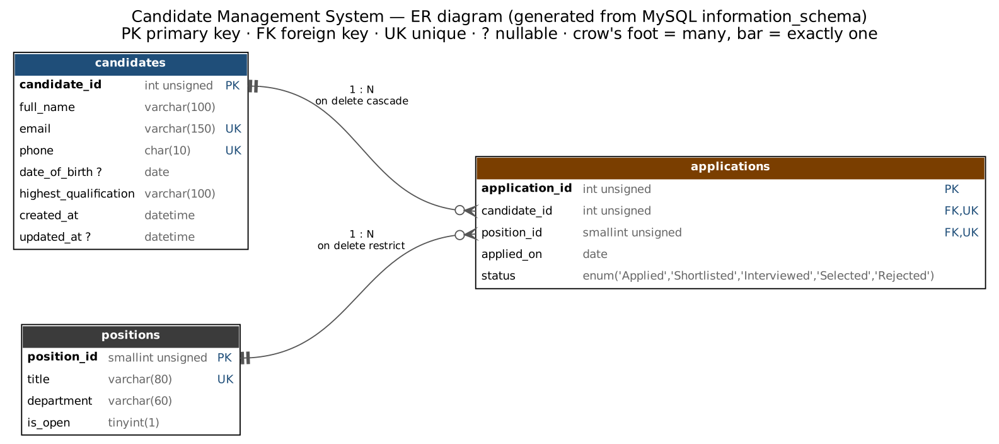

# Experiment 12 — ER diagram



Files: `er_diagram.png`, `er_diagram.svg`, source `er_diagram.dot`. The `.dot` is **generated from the live database** (`information_schema`) by `make_er.php`, so the picture matches the implemented schema exactly:
```bash
php docs/make_er.php && dot -Tsvg docs/er_diagram.dot -o docs/er_diagram.svg && dot -Tpng -Gdpi=130 docs/er_diagram.dot -o docs/er_diagram.png
```

## Entities and attributes
| Entity | Attributes (PK **bold**, UK = unique, ? = optional) |
|---|---|
| Candidate | **candidate_id**, full_name, email UK, phone UK, date_of_birth ?, highest_qualification, created_at, updated_at ? |
| Position | **position_id**, title UK, department, is_open |
| Application (associative entity) | **application_id**, candidate_id FK, position_id FK, applied_on, status — UK(candidate_id, position_id) |

## Relationships and cardinality
| Relationship | Cardinality | Participation | FK / action |
|---|---|---|---|
| Candidate *submits* Application | 1 : N | an application must have a candidate (total); a candidate may have none (partial) | `applications.candidate_id → candidates` ON DELETE CASCADE |
| Position *receives* Application | 1 : N | an application must have a position (total); a position may have none (partial) | `applications.position_id → positions` ON DELETE RESTRICT |

Together these resolve the conceptual **M:N** "Candidate applies for Position", whose own attributes (`applied_on`, `status`) live on Application.

Conceptual (Chen) view:
```
[Candidate] M ───< applies for (applied_on, status) >─── N [Position]
   becomes
[Candidate] 1 ──── N [Application] N ──── 1 [Position]
```
Notation in the picture: bar ‖ = exactly one, circle + crow's foot = zero or many.
